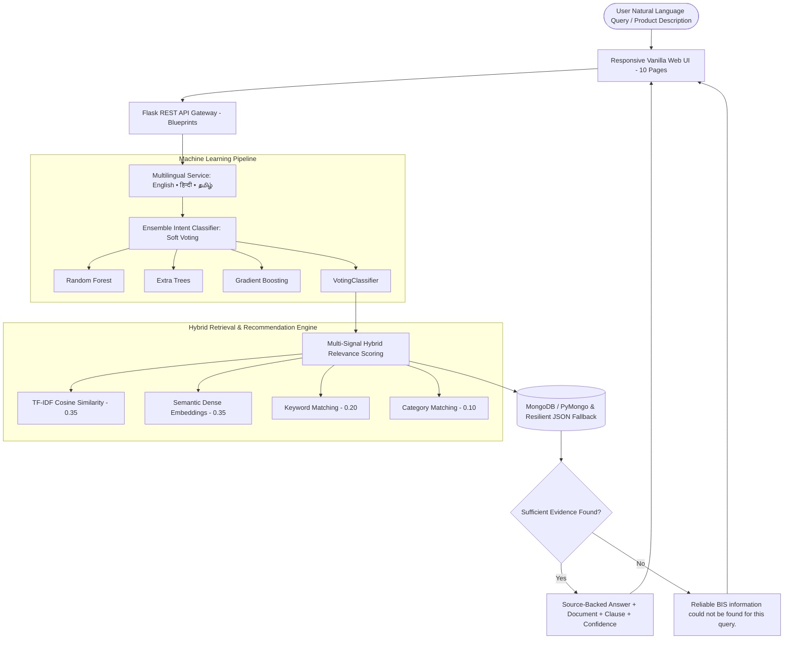

# BIS-AI: Intelligent Assistant for Indian Standards and BIS Services

[](https://www.python.org/)
[](https://flask.palletsprojects.com/)
[](https://scikit-learn.org/)
[](https://www.mongodb.com/)
[](https://developer.mozilla.org/)
[](https://www.bis.gov.in/)

**BIS-AI** is a full-stack, enterprise-grade AI conversational assistant and product-to-standard recommendation system for Indian Standards and Bureau of Indian Standards (BIS) services. Designed specifically for industries, MSMEs, startups, students, and consumers under the **Bureau of Indian Standards Act, 2016**.

The system strictly enforces evidence-based responses: answers cite authorized BIS standards, clauses, URLs, and reference documents. If sufficient evidence is unavailable, the system strictly outputs:  
> *"Reliable BIS information could not be found for this query."*

---

## 🏛️ System Architecture



---

## 🚀 Key System Features

1. **8-Step Verification Workflow:**
   Every conversational inquiry follows a strict 8-step pipeline:  
   `User Query` $\rightarrow$ `Language Detection` $\rightarrow$ `Intent Classification` $\rightarrow$ `Candidate Retrieval` $\rightarrow$ `Relevance Ranking` $\rightarrow$ `Evidence Verification` $\rightarrow$ `Citation Formatting` $\rightarrow$ `Confidence Score`.

2. **Ensemble Machine Learning Pipeline:**
   Classifies queries into 8 intents using an ensemble of **Random Forest**, **Extra Trees**, and **Gradient Boosting** united via `VotingClassifier(voting='soft')`:
   - `STANDARD_RECOMMENDATION`
   - `STANDARD_INFORMATION`
   - `CERTIFICATION`
   - `HALLMARKING`
   - `LABORATORY`
   - `CONSUMER`
   - `GENERAL_BIS`
   - `OTHER`

3. **Product-to-Standard Recommendation Engine:**
   Extracts product names, categories, keywords, and technical terms from natural descriptions. Ranks candidate standards using the exact combined formula:
   $$\text{Final Score} = 0.35 \times \text{TF-IDF} + 0.35 \times \text{Semantic} + 0.20 \times \text{Keyword} + 0.10 \times \text{Category}$$
   Differentiates between **Mandatory Certification** and **Voluntary Conformity**, accompanied by explanatory rationale.

4. **Gold & Silver Hallmarking System:**
   Details hallmarking mandates under BIS Act 2016, karat fineness grades (24K999, 23K958, 22K916, 20K833, 18K750, 14K585), 6-digit laser **HUID** verification, and Fire Assay testing under IS 1418.

5. **Testing Laboratories Directory:**
   Comprehensive directory of BIS Central/Regional labs and NABL-accredited facilities filterable by discipline, city, and tested product.

6. **Certification Guide & MSME Benefits:**
   Explains Scheme I (ISI Mark), Scheme II (CRS), Scheme IV, FMCS, and fee concessions for MSMEs (50% application fee concession, 20% annual marking fee concession) and DPIIT startups.

7. **Multilingual Architecture & Pipeline:**
   - **Supported Languages:** **English** (`en`), **हिन्दी (Hindi)** (`hi`), and **தமிழ் (Tamil)** (`ta`).
   - **Pipeline Workflow:**
     `Input` $\rightarrow$ `Language Detection` $\rightarrow$ `Translation/Normalization` $\rightarrow$ `English NLP Processing` $\rightarrow$ `Intent Classification` $\rightarrow$ `Knowledge Retrieval` $\rightarrow$ `Answer Generation` $\rightarrow$ `Translate response back to user's language`.
   - **Response Metadata Preserved:** Every response explicitly returns:
     - `original_query` (User's verbatim input query)
     - `detected_language` (`en`, `hi`, `ta`, or `unsupported`)
     - `processed_query` (Normalized English query used for downstream NLP & ensemble classification)
     - `answer_language` (`en`, `hi`, or `ta`)
   - **Strict Entity & Code Protection:** Standard numbers (`IS 4151:2020`, `IS 14543:2016`), technical codes (`HUID`, `ISI Mark`, `CRS`, `FMCS`, `NABL`), Karat purity grades (`22K916`, `18K750`), clauses, and official URLs are masked during translation and never corrupted.
   - **Graceful Fallback:** Unsupported scripts automatically and gracefully fall back to English (`answer_language: "en"`).
   - **UI Integration:** The detected language and normalized query are rendered dynamically in the conversational chat interface.

8. **Admin Operations & Self-Retraining:**
   Authenticated endpoints (`X-Admin-API-Key`) allow administrators to ingest new verified records and trigger automated retraining across the ensemble.

---

## 🖥️ Modern React 19 Frontend (Vite + TypeScript + Tailwind CSS + Motion)

The application features a modern, award-caliber frontend built with **React 19, TypeScript, Vite, Tailwind CSS v4, Framer Motion, Lucide React, and Recharts**, with complete Light and Dark theme support.

### Complete 10-Page Experience

| Page # | Page Name | Route | Description & Capabilities |
|---|---|---|---|
| **1** | **Home** | `/` | Linear/Stripe-inspired overview with hero value proposition, search entry, service cards, and live diagnostics status. |
| **2** | **AI Assistant** | `/assistant` | Flagship conversational workspace with Markdown rendering, collapsible verified source citations, and debug telemetry. |
| **3** | **Find Standard** | `/find-standard` | Product-to-standard recommender extracting attributes, mandatory/voluntary status, testing parameters, and score breakdowns. |
| **4** | **Certification Guide** | `/certification` | Expandable guides for Scheme I (ISI Mark), Scheme II (CRS), FMCS, and startup/MSME fee concessions. |
| **5** | **Hallmarking** | `/hallmarking` | Karat fineness grades (24K–14K), 6-digit laser HUID verification rules, and fire assay testing (IS 1418). |
| **6** | **Laboratory Directory** | `/laboratories` | Filterable directory of BIS Central/Regional and NABL-accredited facilities by state, city, and discipline. |
| **7** | **Consumer Help** | `/consumer` | Consumer protection rights, BIS CARE app verification guides, grievance redressal, and FAQ accordion. |
| **8** | **Search Standards** | `/search` | Debounced real-time catalog browser across standard numbers, titles, and industry domains. |
| **9** | **Admin Dashboard** | `/admin` | Authenticated dashboard (`X-Admin-API-Key`) for catalog ingestion, search reindexing, and ensemble retraining. |
| **10** | **ML Analytics** | `/analytics` | System telemetry, Recharts benchmark bar charts, and candidate model evaluation comparison. |

---

## ⚡ Quickstart & Running Instructions

### 1. Run Production Server (Flask serving React build)
```powershell
# In the project root (BIS):
.\.venv\Scripts\python.exe app.py
# Or run using the launcher:
.\run.ps1
```
Open **[http://127.0.0.1:5000](http://127.0.0.1:5000)** in your browser. All 10 routes reload seamlessly via Flask's SPA router.

### 2. Frontend Development Mode (Vite HMR)
```powershell
# Open a new terminal in frontend-react:
cd frontend-react
npm run dev
```
Open **[http://localhost:5173](http://localhost:5173)** in your browser with hot module replacement and automatic API proxying to Flask on port 5000.

### 3. Build Frontend
```powershell
cd frontend-react
npm run build
```
This compiles TypeScript (`tsc -b`) and generates the minified production bundle in `frontend-react/dist`.

## 📁 Project Directory Structure

```
AIML/
├── app.py                         # Application factory & server entry point
├── config.py                      # Unified configurations, paths & hyperparameters
├── requirements.txt               # Python package dependencies
├── .env.example                   # Environment configuration template
│
├── data/
│   ├── raw/                       # Original source datasets
│   ├── processed/                 # Validated & normalized CSV datasets
│   ├── knowledge_base/            # Master indexed JSON knowledge base
│   ├── training/                  # Intent classification training datasets
│   ├── data_quality_report.json   # Generated data quality metrics
│   └── standards.json             # Cached seed data for standards
│
├── ml/
│   ├── preprocessing.py           # Text cleaning, multilingual normalizer & TF-IDF
│   ├── train_intent_model.py      # Ensemble model training (RF + ET + GB + Voting)
│   ├── evaluate_models.py         # Model evaluation, classification reports & confusion matrix
│   ├── predict_intent.py          # Real-time intent prediction function
│   └── model_loader.py            # Singleton model loader
│
├── models/
│   ├── voting_ensemble_model.joblib # Persisted ensemble model artifact
│   ├── intent_preprocessor.joblib   # Persisted TF-IDF & label encoder
│   ├── model_comparison.json        # Comprehensive evaluation metrics & confusion matrix
│   └── evaluation_metrics.json      # Benchmark statistics
│
├── services/
│   ├── conversational_assistant.py # 8-step verification pipeline & guardrails
│   ├── recommendation_engine.py    # 4-signal hybrid relevance ranker
│   ├── product_analyzer.py         # Product, keyword & technical term extractor
│   └── multilingual.py             # English, Hindi & Tamil detector & translator
│
├── retrieval/
│   └── retriever.py               # Hybrid retriever combining TF-IDF & dense embeddings
│
├── database/
│   ├── db.py                      # MongoDB / PyMongo client with resilient JSON fallback
│   └── seed.py                    # Dataset seeding & indexing utility
│
├── routes/
│   ├── chat_routes.py             # /api/chat, /api/predict-intent, /api/recommend-standard
│   ├── public_routes.py           # Public endpoints (/standards, /certification, /laboratories, etc.)
│   └── admin_routes.py            # Authenticated admin routes (/knowledge, /analytics, /retrain)
│
├── utils/
│   ├── auth.py                    # Admin API key authentication decorator
│   └── response.py                # Standardized JSON response envelope
│
├── frontend/
│   ├── index.html                 # 10-page single page interface
│   ├── css/style.css              # Custom institutional theme styling
│   └── js/app.js                  # Vanilla client logic, routing & Chart.js integration
│
├── scripts/
│   ├── ingest_pipeline.py                 # Data validation, deduplication & quality reporting
│   ├── run_comprehensive_evaluation.py    # Complete test runner (ML, Retrieval, Latency, 14 Scenarios)
│   └── generate_dataset.py                # Dataset generator
│
├── tests/
│   ├── test_complete_system.py            # Comprehensive 14-scenario system test suite
│   ├── test_rest_api.py                   # 16 REST API endpoint tests
│   └── test_system.py                     # 14 System, ML & multilingual integration tests
│
└── docs/
    ├── final_evaluation_report.md         # Comprehensive evaluation report (ML, IR, Latency, 14 Tests)
    ├── data_quality_report.md             # Markdown data quality report
    └── model_comparison.md                # ML ensemble evaluation report
```

---

## 🛠️ Installation & Setup

### Prerequisites
- **Python 3.10+** (Tested on Python 3.13)
- Optional: **MongoDB** running locally on port 27017 (System automatically falls back to built-in JSON mode if MongoDB is not present)

### Step 1: Install Dependencies
```powershell
pip install -r requirements.txt
```

### Step 2: Configure Environment
Copy `.env.example` to `.env` and configure your settings:
```powershell
Copy-Item .env.example .env
```
In `.env`, configure your Grok API credentials (xAI) or Groq credentials:
```env
# Grok API (xAI) Configuration [PRIMARY]
GROK_API_KEY=your_xai_grok_api_key_here
GROK_BASE_URL=https://api.x.ai/v1
GROK_MODEL=grok-2-latest
GROK_TIMEOUT=20.0
GROK_MAX_TOKENS=1000
GROK_TEMPERATURE=0.2

# Backward Compatibility (GroqCloud fallback)
# GROQ_API_KEY=your_groqcloud_api_key_here
# GROQ_MODEL=openai/gpt-oss-120b
```
*(Note: Never commit your `.env` file or API key to Git. Sane fallbacks exist so the application starts and functions reliably with deterministic BIS guidance even when offline or without an API key).*

### Step 3: Run Ingestion & Data Quality Pipeline
```powershell
python scripts/ingest_pipeline.py
```
*Validates records, removes duplicates, checks required metadata, and generates `docs/data_quality_report.md`.*

### Step 4: Train Ensemble Machine Learning Models
```powershell
python ml/train_intent_model.py
python ml/evaluate_models.py
```
*Trains Random Forest, Extra Trees, Gradient Boosting, and the Voting Ensemble; saves `models/voting_ensemble_model.joblib` and evaluation metrics.*

### Step 5: Execute Complete Testing & Evaluation System
```powershell
# 1. Run the comprehensive evaluation & benchmarking runner:
python scripts/run_comprehensive_evaluation.py

# 2. Run the complete pytest test suite (133 tests including 20 regression benchmark tests):
python -m pytest tests/ -v
```

---

## 🤖 Grok AI & Knowledge-Augmented Architecture

The application pairs authoritative BIS information retrieval with the **Grok API** (xAI `grok-2-latest` with GroqCloud compatibility):

1. **Non-Blocking Architecture:** Local dataset records ground and verify the response when available, but a missing catalog record no longer blocks Grok from answering general, institutional, or conceptual BIS questions (e.g., "What is BIS?", "Explain gold hallmarking", "What is the purpose of conformity assessment?").
2. **Grounded Context Injection:** When catalog candidate records are retrieved, they are provided to Grok as structured evidence with standard numbers, clauses, and source URLs.
3. **Strict Zero-Hallucination Prompting:** The system prompt explicitly commands Grok to:
   - Ground technical details strictly in retrieved records.
   - Never invent standard numbers, QCO notification dates, exact certification fees, or clause citations.
   - Distinguish verified facts from general guidance.
   - When answering without catalog records, clearly explain how the user can verify official requirements via manakonline or bis.gov.in.
4. **Multi-Turn Context & Conversation History:** The assistant accepts and maintains a `history` array across turns, allowing users to ask follow-up questions and resolve pronouns naturally.
5. **Resilient Fallback:** If Grok encounters rate limits (429), timeouts, or if the API key is unconfigured, the assistant automatically and seamlessly falls back to deterministic, verified BIS guidance.
6. **No Secret Leakage:** The API key is loaded server-side only; it is never logged, exposed to the browser, or included in test suites.

### Diagnostic & Status Endpoints
- `GET /api/diagnostics` — Returns real-time health and configuration status of the Grok AI integration, catalog counts, and operational mode without exposing secrets.
- `GET /api/grok/status` — Live status of the Grok API connection.

### Troubleshooting Grok Integration
- **Missing API Key (`is_available() == False`):** The server starts normally and provides verified deterministic BIS guidance.
- **HTTP 401 Unauthorized:** Occurs if the API key is mistyped or revoked. Safely logged without exposing keys, returning fallback guidance.
- **HTTP 429 Rate Limit:** The request gracefully degrades to deterministic guidance without crashing Flask or showing "insufficient data".
- **Request Timeout:** Configured by default to 20.0 seconds. Upstream delays trigger an immediate safe fallback.


## 💻 Running the Application Locally

Start the server using:
```powershell
python app.py
```

Open your browser and navigate to:
```
http://127.0.0.1:5000
```

---

## 📡 REST API Reference

### Conversational & ML Endpoints
- `POST /api/chat` — Source-backed assistant Q&A. Accepts `{"query": "..."}`. Returns 8-step verified response with citations.
- `POST /api/predict-intent` — Classifies user query intent using the Voting Ensemble. Returns `{"intent": "...", "confidence": 0.0, "model": "Voting Ensemble"}`.
- `POST /api/recommend-standard` — Maps product descriptions to Top 5 Indian Standards with 4-signal score breakdowns.

### Public Directory Endpoints
- `GET /api/standards` — Retrieve all Indian Standards (optional `?category=...`).
- `GET /api/standards/<standard_id>` — Retrieve standard by ID or standard code.
- `GET /api/certification` — Retrieve all BIS certification schemes and MSME concessions.
- `GET /api/hallmarking` — Retrieve hallmarking guidelines, fineness grades, and HUID rules.
- `GET /api/laboratories` — Retrieve testing laboratories (optional `?city=...&state=...`).
- `GET /api/consumer` — Retrieve consumer grievance procedures and FAQs.
- `GET /api/metrics` — Retrieve ML ensemble benchmarks, accuracy, and confusion matrix.
- `GET /api/health` — Check system health and database operational mode.

### Administrative Endpoints
*(Requires HTTP Header `X-Admin-API-Key: bis_admin_secret_key_2026`)*
- `GET /api/admin/analytics` — Fetch system telemetry, intent distribution, inventory counts, and query audit logs.
- `POST /api/admin/knowledge` — Ingest and index a new verified standards or services record.
- `PUT /api/admin/knowledge/<record_id>` — Update an existing knowledge record and auto-rebuild search index.
- `DELETE /api/admin/knowledge/<record_id>` — Remove a record and auto-rebuild search index.
- `POST /api/admin/rebuild-index` — Manually trigger search index and vector space rebuilding.
- `POST /api/admin/retrain` — Trigger automated retraining of the ensemble model.
- `GET /api/admin/metrics` — View full ML evaluation metrics and confusion matrix.

---

## 📊 Machine Learning Model Benchmarks

| Model | Accuracy | Precision (Weighted) | Recall (Weighted) | Macro F1 | Weighted F1 |
|---|---|---|---|---|---|
| **Random Forest** | 68.18% | 77.06% | 68.18% | 65.76% | 67.92% |
| **Extra Trees** | 68.18% | 78.03% | 68.18% | 66.67% | 70.91% |
| **Gradient Boosting** | 68.18% | 72.35% | 68.18% | 63.21% | 68.66% |
| **Voting Ensemble (Selected)** | **68.18%** | **75.38%** | **68.18%** | **64.46%** | **68.20%** |

*All metrics are viewable with interactive Chart.js visualizations in the **ML Analytics** page of the web UI.*

---

## ⚖️ Legal & Data Disclaimer

*All authoritative information is indexed from public publications of the **Bureau of Indian Standards (bis.gov.in)**, the **Ministry of Consumer Affairs, Government of India**, and the **Compulsory Registration Scheme Portal (crsbis.in)**. Demonstration and benchmark records are clearly labelled as **SAMPLE DATA** and never presented as official unverified requirements.*
